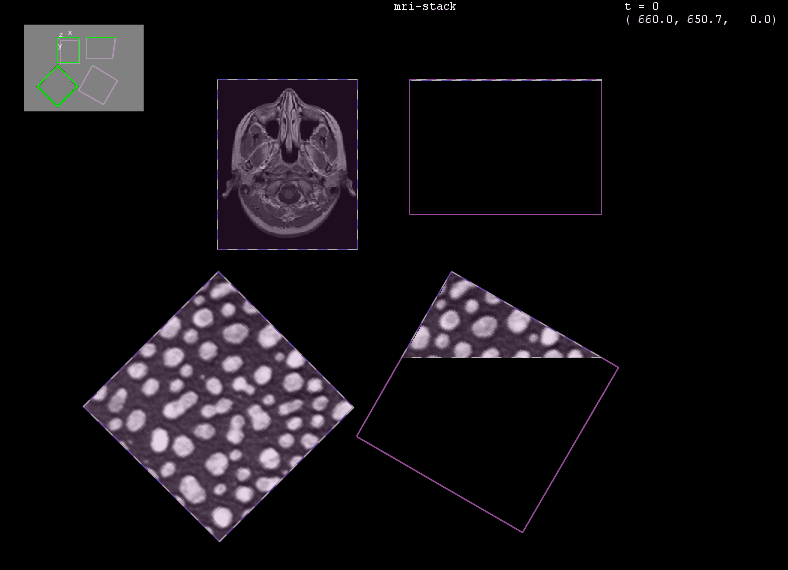

[](https://github.com/BIOP/bigdataviewer-selector/actions/workflows/build-main.yml)
[](https://maven.scijava.org/#browse/browse:releases:ch%2Fepfl%2Fbiop%2Fbigdataviewer-selector)


# BigDataViewer Selector Module

Extensible module to graphically or programmatically select sources present in BigDataViewer.



## Usage

Attach a `SourceSelectorBehaviour` to a `BdvHandle` and listen to the selection changes:

```java
BdvHandle bdvh = ...;

// 'E' toggles the selection mode on and off
SourceSelectorBehaviour ssb = new SourceSelectorBehaviour(bdvh, "E");

ssb.addSelectedSourcesListener(new SelectedSourcesListener() {
    @Override
    public void selectedSourcesUpdated(
        Collection<SourceAndConverter<?>> selectedSources, String triggerMode) {
        // the complete selection, after the change
    }

    @Override
    public void lastSelectionEvent(
        Collection<SourceAndConverter<?>> lastSelectedSources,
        String mode, String triggerMode) {
        // only the sources involved in the change, and how (SET / ADD / REMOVE)
    }
});
```

The selection can also be driven programmatically, whether the selection mode is
enabled or not, with `selectedSourceAdd`, `selectedSourceRemove` and
`selectedSourcesClear`. Use `addToggleListener` to switch your own behaviours on
and off together with the selection mode.

`SourceNameOverlay` is available separately, as a plain `BdvOverlay`, if all you
need is to display the name of each visible source:

```java
BdvFunctions.showOverlay(new SourceNameOverlay(bdvh.getViewerPanel()),
    "Sources Name", BdvOptions.options().addTo(bdvh));
```

See [`BdvSelectorDemo`](src/test/java/BdvSelectorDemo.java) for a complete
example, including a helper which preserves the number of timepoints when an
overlay is added to or removed from a BigDataViewer window.

## Key bindings

The selection mode has to be toggled on before the selection bindings become
active. Selecting is done by dragging a rectangle over the sources; a single
click works as well.

| Command name                  | Default   | Action                                                     |
|-------------------------------|-----------|------------------------------------------------------------|
| `source-selector-toggle`      | `E`       | Toggle between the selection mode and the navigation mode  |
| `select-set-sources`          | `button1` | Select the sources in the rectangle, dropping the previous selection |
| `select-add-sources`          | `shift button1` | Add the sources in the rectangle to the selection    |
| `select-remove-sources`       | `ctrl button1`  | Remove the sources in the rectangle from the selection |
| `select-all-visible-sources`  | `ctrl A`  | Add every visible source to the selection                  |

These bindings are listed in the BigDataViewer preferences dialog
(`Settings > Preferences > Keymap`) and can be re-bound there like any other
BigDataViewer command, provided the selector is built with the
`InputTriggerConfig` of the window's `Keymap`:

```java
Keymap keymap = ...; // e.g. from your KeymapManager
SourceSelectorBehaviour ssb =
    new SourceSelectorBehaviour(bdvh, keymap.getConfig(), "E");
keymap.updateListeners().add(() -> ssb.updateKeyConfig(keymap.getConfig()));
```

Without that, the defaults above apply and cannot be changed by the user.

A source stays selected while you browse the timepoints, including at the
timepoints where it holds no data, so that a selection can be built up across
the whole time range. The selection is also preserved when the selection mode is
disabled and enabled again. Sources removed from the window, or made invisible,
are dropped from the selection.

## Styling

The colors and strokes of the overlay are read from the two `OverlayStyle`
instances held under the `"DEFAULT"` and `"SELECTED"` keys of
`getSourceSelectorOverlay().getStyles()`, and can be replaced with your own
implementation. `getFrontColor()` is the color of the source names, and
`getTextOutlineColor()` the color of the outline drawn around them, which keeps
the names readable over bright image data — return `null` there for no outline.

Source names can be hidden altogether with
`getSourceSelectorOverlay().hideSourcesNames()`.
